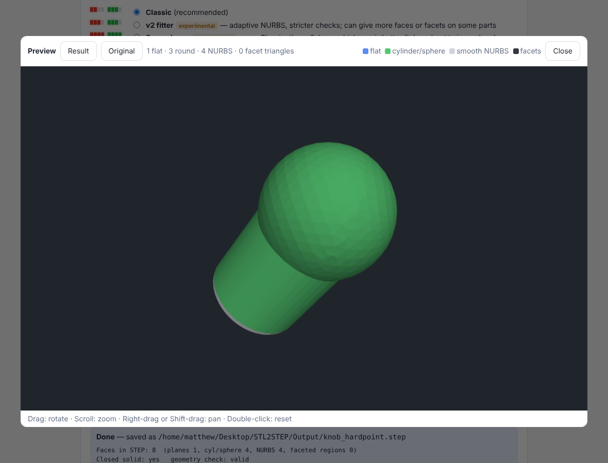
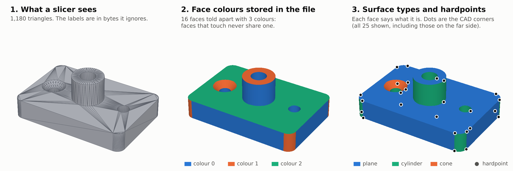
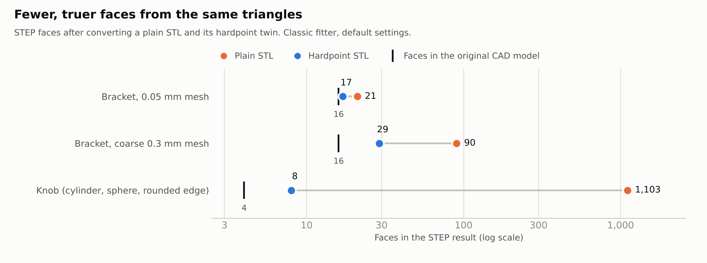

<!-- GENERATED from paper/paper.md by tools/make_readme.py. Edit the paper, then run the tool. -->
# A <u>**POINT**</u> of contention

**STL to STEP conversion shouldn't be that HARD: a proposed hybrid STL format that is CAD-friendly and slicer-compatible**

**Converting an STL back to a STEP file means guessing the original CAD faces. This paper proposes a normal binary STL that also records them, so slicers still open it and converters no longer have to guess. It is also a public, dated description of the format, and a list of the ideas that didn't work.**

Matthew Armstrong · GitHub [The-Dorkknight](https://github.com/The-Dorkknight) · United Kingdom\
First published 15 October 2026 · Version 1.0\
Text and figures: [CC BY-SA 4.0](https://creativecommons.org/licenses/by-sa/4.0/). Code that comes with it: [PolyForm Noncommercial 1.0.0](https://polyformproject.org/licenses/noncommercial/1.0.0/).

📄 **[PDF](paper/a-point-of-contention-v1.0.pdf)** · 🌐 [Web page](https://The-Dorkknight.github.io/a-point-of-contention/) · 🔧 [The FreeCAD and Fusion plug-ins](https://github.com/The-Dorkknight/hardpoint-stl) · [About this repository](#about-this-repository)

This page is the full paper (the same text and figures as the PDF).

**Contents:** [Abstract](#abstract) · [Why I wrote this](#0-why-i-wrote-this) · [The problem: what STL loses, and how slicers read it](#1-the-problem-what-stl-loses-and-how-slicers-read-it) · [Prior art: what I found (3–10 October 2026)](#2-prior-art-what-i-found-310-october-2026) · [How the idea was judged](#3-how-the-idea-was-judged) · [The ideas that didn't work](#4-the-ideas-that-didnt-work) · [The format, in one picture](#5-the-format-in-one-picture) · [Does it help?](#6-does-it-help) · [What works, and what doesn't yet](#7-what-works-and-what-doesnt-yet) · [Defensive disclosure: the hardpoint STL and variations](#8-defensive-disclosure-the-hardpoint-stl-and-variations) · [What I'd test next (feel free to use this plan)](#9-what-id-test-next-feel-free-to-use-this-plan) · [Working together](#10-working-together) · [How this was made](#11-how-this-was-made) · [Code, data and how to reproduce](#12-code-data-and-how-to-reproduce) · [Licence, and keeping it free](#13-licence-and-keeping-it-free) · [Disclaimers](#14-disclaimers) · [How to cite](#15-how-to-cite) · [References](#references) · [Appendix A: a real hardpoint STL](#appendix-a-a-real-hardpoint-stl)

> **Status: nothing in this paper has been run in real FreeCAD, in Fusion, or in a slicer.** The format and its reference code were tested on Linux, using test parts built with OpenCASCADE and the file-reading code that slicers use (not the slicers themselves). The FreeCAD and Fusion exporters were only tested against stand-ins for those programs. The conversion results come from one converter of mine. If you open the example files in your slicer before I do, please tell me what happened.

> **Not legal advice.** I am not a lawyer. Where this paper talks about prior art, it says what I found, where I found it, and when. A patent attorney is the person to ask about what it means.

| Plain STL: 1,103 faces | Hardpoint STL: 8 faces |
| --- | --- |
|  |  |

*The same knob, made from the same triangles, converted to STEP. Left: from a plain STL, which came out with 1,103 faces. Right: from the hardpoint version of the file, which came out with 8 faces. The original CAD model has 4.*

---

## Abstract

An STL file is just a pile of triangles. It has lost everything the CAD program knew: which triangles made up one flat face, which made up a round hole, and where the corners were. Turning an STL back into a real CAD solid means guessing all of that again, and the guesses go wrong most often on coarse meshes and curved edges.

This paper describes a way to keep that information in the file without breaking it for anyone else:

- **The idea:** write the CAD facts into the two places a binary STL already has spare room that slicers ignore: the 80-byte header, and the 2-byte "attribute" field after every triangle.
- **What goes in:** which face each triangle belongs to (as a small colour number, like colouring a map so that neighbouring areas differ), what kind of surface the face is, and which triangle corners are CAD vertices ("hardpoints"). A checksum in the header shows whether the mesh was edited afterwards.
- **What a slicer sees:** the same triangles, the same file size, the same `.stl` extension.
- **How much it helps:** in my tests, a converter given the labelled file turned a knob into a STEP solid with 8 faces. From the same triangles without labels it made 1,103 faces (the original CAD model has 4). On a clean, fine bracket the gain was small: 21 faces down to 17, against 16 in the original.
- **What didn't work:** data after the last triangle, a 9-bit face number, hiding the whole STEP file inside the STL, remembering how freeform faces were cut up, and a handful of mistakes along the way.

Section 8 describes the format and its variations in enough detail to build them. It is written as prior art, so the method stays free for everyone to use.

---

## 0. Why I wrote this

How it started:

1. I convert STL files into STEP files. Most of the converter's effort goes on working out again what the CAD program already knew.
2. The CAD program could say it at the moment it writes the STL. Instead it throws the answer away.
3. A binary STL has two spare places that slicers ignore. I'm a hobbyist in the UK with a laptop, and I wanted to see if the answer could be kept there.

So I built the **hardpoint STL**, plus an exporter for FreeCAD and one for Fusion. First I researched how slicers read STL files. Then I tried to find every way a file like this could break them.

**Why publish all of this, including the failures?** Four reasons:

1. **Protection.** I looked, and found no earlier description of putting CAD face labels inside an STL (section 2). If that is right, a dated, detailed public description is a cheap way to keep the idea free for hobbyists. That is what a *defensive publication* is.
2. **Saving you time.** Every dead end here is one you don't have to walk down. The best one began as a question of mine that turned out to have a simple numerical answer (section 4.3).
3. **Getting other people involved.** The format has room for more exporters (CadQuery, Onshape, SolidWorks) and more readers than I can write.
4. **Selfishly:** by my calculations, a third paper makes me about 0.7 % more employable. The first was worth 22.7 % and the second 3.14 %, so the returns are falling. That's probably fine. Publish too many and I start to look like I have a lot of free time, and nobody wants to hire someone who looks that available.

**How this was made.** The ideas, the questions and the rules are mine. The code, the tests, the measurements and the first draft of this write-up were done with an AI assistant (Claude, by Anthropic), working to my design. All sources are linked so you can check them, and the code is included so you can re-run every number that can be re-run (section 12).

---

## 1. The problem: what STL loses, and how slicers read it

### 1.1 What gets lost

A CAD solid is made of faces: planes, cylinders, spheres, cones, tori and freeform surfaces, joined along edges and corners. Exporting it as STL cuts every face into triangles and writes only the triangles. A flat face and a rounded edge of the same bracket both end up as nothing but triangles.

A mesh-to-CAD converter has to work out again which triangles form one flat face (and how flat is flat enough?) and which form a curve. When the mesh is coarse, or a curve meets a flat face very gently, it can't always tell.

### 1.2 What I set myself

The design had to meet six requirements, in this order:

1. **Recognised as an STL.** The extension stays `.stl` and the file loads in any slicer without a plug-in.
2. **Identical to a normal STL in a slicer.** Same triangles, same file size, nothing a slicer acts on.
3. **Makes STL-to-STEP conversion easier.** It carries what a converter otherwise guesses: faces, surface types, corners.
4. **Writable from inside CAD programs.** FreeCAD's and Fusion's own Python can't be assumed to have NumPy, so the writer uses the standard library only.
5. **Never makes a conversion worse.** Labels are hints. The reader checks each one.
6. **Runs on low-end hardware.** The target machine is a 7th-generation Core i3.

### 1.3 What STL readers do with a file

A binary STL has an 80-byte header, a 4-byte triangle count, then 50 bytes per triangle: 12 for the normal, 36 for three corners, and 2 for an "attribute byte count" that slicers ignore. So there are exactly two places that carry no meaning to a slicer. Anything after the last triangle is a different matter.

| Reader | Used by | Binary or text test | Triangle count | Extra bytes at the end | How this is known |
| --- | --- | --- | --- | --- | --- |
| admesh `stlinit.cpp` | OrcaSlicer; PrusaSlicer-family slicers share this code | Binary if any of the 128 bytes after offset 84 is above 127 | Taken from the file size; the header count only logs a warning | Rejected unless a multiple of 50, then read as phantom triangles | Read [OrcaSlicer's source](https://raw.githubusercontent.com/OrcaSlicer/OrcaSlicer/main/deps_src/admesh/stlinit.cpp) (PrusaSlicer's and Bambu Studio's copies not read) |
| numpy-stl | Cura, through [Uranium's STLReader](https://raw.githubusercontent.com/Ultimaker/Uranium/main/plugins/FileHandlers/STLReader/STLReader.py) | Automatic mode | From the header | Load fails with an error | Read Uranium's source; ran the library |
| trimesh | many Python tools | Binary only if the size is exactly 84 + 50 × count, otherwise tried as text | From the header | Not binary, then fails as text (0 faces) | Read [trimesh's source](https://raw.githubusercontent.com/mikedh/trimesh/main/trimesh/exchange/stl.py); ran the library |

Other findings that shaped the format:

- **The admesh text test misreads simple files.** A cube at whole-millimetre coordinates with zero normals has no byte above 127 in that window, so it is read as text and imports empty. This is [OrcaSlicer issue 15993](https://github.com/OrcaSlicer/OrcaSlicer/issues/15993), open when I checked on 3 October 2026. A probe copying the test's logic reproduced it.
- **The header must not start with `solid`.** Some software then treats the file as text ([Wikipedia](https://en.wikipedia.org/wiki/STL_(file_format))).
- **Two colour conventions already use the attribute field.** VisCAM and SolidView: bits 0–4 blue, 5–9 green, 10–14 red, bit 15 = 1 means the colour is valid. Materialise Magics: a `COLOR=` string in the header, bits 0–4 red, 5–9 green, 10–14 blue, bit 15 = 0 means the triangle has its own colour (both as described on Wikipedia).
- **trimesh drops the attribute field during clean-up.** With `process=True` it survives vertex merging, but removing sliver triangles rebuilds the mesh. On one test part 5,572 triangles became 5,564 and the field was gone.

---

## 2. Prior art: what I found (3–10 October 2026)

Using the attribute bytes of an STL for something other than "nothing" is old: the two colour conventions above are the best-known uses. What I looked for was a file that keeps **CAD face identity, surface types and CAD vertices** inside an ordinary STL.

- **I found no description of that.** The searches were ordinary web and code searches by me and my AI assistant, over a few days. They are not a professional prior-art search, and a miss here proves little.
- **Existing mesh-to-STEP tools** ([stlToSolid](https://github.com/Crypto69/stlToSolid), [breptile](https://pypi.org/project/breptile/0.1.0/)) segment the mesh and fit primitives from the triangles alone. As far as I could tell neither reads hints from the file.
- **The standard container for "a mesh plus the real CAD in one file"** is 3MF, which is a zip. It is not an STL, and I did not test how slicers treat an extra file inside one.

Whether any of this affects anyone's rights is a question for lawyers, not me.

---

## 3. How the idea was judged

I can't build exact CAD parts by hand, so I had a CAD kernel make them:

1. **Test parts.** Two parts built with OpenCASCADE (the kernel FreeCAD uses): a bracket (rounded corners, three holes, a boss, a countersink) and a knob (cylinder, sphere, torus fillet). The bracket was meshed at two settings.
2. **Twin files.** Each mesh was written twice with identical triangles: once labelled, once as a plain STL.
3. **The converter.** Both files went through STL2STEP, an earlier converter of mine (since superseded; its code is not in this repository), default settings. I counted the faces in the STEP result, the largest distance from the mesh, and the volume against the original CAD solid.
4. **The format itself.** Round trips (write, read back, compare faces, types and hardpoints), tamper checks, and the loaders of section 1.3.

**What this gets wrong** (please read before quoting a number):

- Three test parts, built for the tests. No real downloaded models.
- One converter. Another converter may use the labels better or worse.
- Linux only. The writer was timed on a cloud machine, not on a Core i3.
- The FreeCAD and Fusion code ran against stand-ins with the same attribute names, filled with OpenCASCADE geometry. That checks the plug-ins' own logic and nothing about how the real programs behave.

---

## 4. The ideas that didn't work

### 4.1 The table

Seven ideas were built or tested and then dropped. Each row says what the evidence was, so nobody repeats the experiment blind.

| Idea | What happened | Evidence |
| --- | --- | --- |
| Store extra data after the last triangle | Loaders fail or read garbage | numpy-stl raised an error, trimesh loaded 0 faces, admesh's logic reads phantom triangles |
| A global face number in 9 bits | Replaced by colours | Capped at 511 faces; colours need 2 to 5 values for any count |
| Hide the STEP file itself in the STL | It doesn't fit as text, and only sometimes when compressed | Section 4.3 |
| Remember how a freeform face was cut into patches (a second, 3-bit "patch colour") | Faster but worse, so removed | Organic part: 83 s down to 19 s, but 20 areas left as facets instead of 2 and maximum deviation 0.16 mm instead of 0.12 mm |
| Let the converter's normal detection handle cone and torus faces | It chopped them into cylinder and sphere pieces | Knob: 131 STEP faces and 3 failed faces, against 8 faces when treated as freeform |
| Label a whole-body mesh by nearest triangle centre | Mislabelled triangles beside face borders | About 1 % wrong on the knob, which turned into 11 false flats and 315 STEP faces. Point-to-triangle distance gave 100 % |
| Carry the attribute field through trimesh's clean-up | Lost whenever slivers are removed | 5,572 triangles became 5,564 with no attribute data. Matching by position replaced it |

A likely reason saved patch layouts gave a worse result (not proven): the fit of a patch depends on its border curves, and the converter smooths those borders step by step over several passes. Starting from the final layout skips the steps that made it fit.

### 4.2 Mistakes along the way

These are in the order they happened. Most were the AI assistant's, and they were caught by tests I had asked for.

**1. A missing triangle.** The knob's sphere has a pole where one triangle collapses to a line once nearby points are welded. The writer rightly dropped it (1 of 2,959). The tests then compared labels with the wrong triangles, because the output order no longer matched the input. The encoder now reports which input triangle sits at each output position.

**2. About 1 % of triangles mislabelled.** Fusion's fallback labels a whole-body mesh from per-face meshes. First version: nearest triangle centre. It looked fine in a picture and mislabelled about 1 % of triangles beside face borders, which a converter read as 11 flat faces and 315 STEP faces. Point-to-triangle distance fixed it.

**3. A flat disc shown as rough facets.** The converter's preview showed the top of the bracket's boss as dark left-as-facets. The rule that called a planar face a facet was "three edges or fewer"; a flat disc bounded by one circle qualifies. It now also requires every edge to be straight.

**4. A renamed OpenCASCADE method.** The test code called `TopoDS.Edge_s`, which doesn't exist in the OCP 8 build installed. A small compatibility helper hides the difference.

**5. A changelog that claimed too much.** I compared my changelog with the public repository of the converter on the day I packaged it. Five bullets under the published version had been added after it was published. They moved to the new version's section.

**6. Screenshots taken at the wrong moment.** Two documentation screenshots showed a job queue card and a sandbox folder name. They were retaken in a clean state.

**7. A plug-in never tried in its real program.** I could not install FreeCAD where this was built: its release downloads, conda-forge, the Ubuntu package source, the PPA and Flathub were all blocked, and I did not route around the block. So the workbench ran only against stand-ins. In its place, `tests/freecad_selfcheck.py` runs inside the real program in a few seconds. It has not been run either. I keep repeating that because it is the most useful thing a reader could check.

### 4.3 Could the whole STEP file be hidden in the STL?

Partway through I asked: would it be easier to hide a STEP file inside the STL as plain text? It was worth checking, because it would give the exact CAD model back with no fitting at all.

It doesn't fit. The room in an STL grows with the triangle count (2 bytes each), while the size of a STEP file grows with the number of faces:

| Part | STEP file | STEP compressed | Attribute room (2 bytes × triangles) |
| --- | --- | --- | --- |
| Bracket, 1,180 triangles at 0.05 mm | 48.1 KB | 6.6 KB | 2.3 KB |
| Knob, 2,958 triangles | 9.3 KB | 2.1 KB | 5.8 KB |

Simple parts with big flat faces fit worst. A text (ASCII) STL has no comment syntax; from reading OrcaSlicer's reader, extra text lines inflate its triangle count and the load fails (read, not run). A compressed STEP would also need every attribute bit, including bit 15, and would compete with the labels for the same bytes. It could be an optional extra: store it when it fits, fall back to labels when it doesn't. That is a variation in section 8.6, not a result.

---

## 5. The format, in one picture

*Drawn from the specification by `tools/make_illustrations.py`.*

**Header** (80 bytes of ASCII, padded with spaces):

    HARDPOINT-STL 1 u=mm tol=0.05 ang=15 crc=e67609a0 by=cad-example

| Field | Meaning |
| --- | --- |
| `HARDPOINT-STL 1` | Marker and format version |
| `u` | Units: `mm`, `in`, `cm` or `m` |
| `tol` | How far triangles may be from the true surface, in those units; 0 = unknown |
| `ang` | Meshing or sharp-edge angle in degrees; 0 = unknown |
| `crc` | CRC-32 of the 48 geometry bytes (normal and corners) of every triangle, in file order |
| `by` | What wrote the file |

**Attribute field** (16 bits per triangle, little-endian):

| Bits | Meaning |
| --- | --- |
| 0–4 | Face colour, 0 to 31. Faces that touch along an edge never share a colour |
| 5–6 | Reserved, 0 |
| 7 | 1 = this triangle is labelled |
| 8–10 | Surface type: 0 unknown, 1 plane, 2 cylinder, 3 sphere, 4 cone, 5 torus, 6 freeform, 7 keep as facets |
| 11–13 | Hardpoint flags for corner 1, 2 and 3 of the triangle |
| 14 | Reserved, 0 |
| 15 | Always 0 (some viewers read bit 15 = 1 as "this field is a colour") |

*The bracket example (`examples/bracket_hardpoint.stl`): 1,180 triangles, 16 faces labelled with 3 colours, 25 hardpoints. Drawn from the file itself.*

Why these choices (every one follows from section 1.3 or from a measurement):

| Question | Chosen | Rejected | Why |
| --- | --- | --- | --- |
| Where the labels live | Header and attribute fields | Data after the last triangle | A trailer fails in numpy-stl and trimesh and becomes phantom triangles in admesh |
| How a face is identified | A 5-bit colour; a face is the edge-connected triangles sharing it | A global face number | Colours label any number of faces. Test parts needed 2 to 5 colours |
| Surface parameters (plane, axis, radius) | Not stored; the reader fits them | A parameter table | No room without a trailer. Fitting is cheap once the faces are known, and a reader must verify anyway |
| CAD vertices | 3 bits per triangle, one per corner | A separate vertex list | No room. Needed where only two faces meet but a line runs into an arc |
| Detecting edits | CRC-32 of the triangle data in the header | No check | Stale labels on an edited mesh would mislead the converter |
| "Labelled" flag | Bit 7, and a labelled triangle is written first | A separate guard | Bit 7 of the first attribute byte also defeats the admesh text misread |
| Bit 15 | Always 0 | Free use | VisCAM-style viewers read bit 15 = 1 as a colour |
| Trust | Every label is checked against tolerance | Believe the file | A wrong or stale label must not produce a wrong solid |

---

## 6. Does it help?

Labels helped most on a coarse mesh and on a part with a sphere and a rounded edge. On a clean, fine mesh of flats and cylinders they changed little.

Volume error is the STEP solid against the original CAD solid (bracket 24,490.97 mm³, knob 12,347.01 mm³). Converter: STL2STEP 0.2.0-wip, Classic engine, default settings.

| Part | Triangles | Plain: STEP faces | Plain: volume error | Plain: max deviation | Hardpoint: STEP faces | Hardpoint: volume error | Hardpoint: max deviation |
| --- | --- | --- | --- | --- | --- | --- | --- |
| Bracket, 0.05 mm mesh | 1,180 | 21 | −0.013 % | 0.050 mm | 17 | +0.001 % | 0.049 mm |
| Same bracket, coarse 0.3 mm mesh | 578 | 90 | −0.075 % | 0.109 mm | 29 | +0.002 % | 0.086 mm |
| Knob, 0.05 mm mesh | 2,958 | 1,103 | −0.18 % | 0.129 mm | 8 | +0.007 % | 0.060 mm |

- On the coarse bracket the plain conversion found 55 "flat" faces where the CAD model has 7.
- On the knob, the plain conversion took 14 s and the labelled one 2 s. The converter's second engine showed the same pattern in face counts: 21 to 17, 125 to 17 and 77 to 8.
- The CAD models have 16 faces (bracket) and 4 (knob), so even with labels the converter returns slightly more than the original. Cone and torus faces are labelled but the converter fits them as freeform surfaces.

The knob in the converter's own 3D preview, from the plain STL and from its hardpoint twin (same triangles; blue = flat, green = cylinder or sphere, grey = freeform surface, dark = left as facets):

| Plain STL: 1,103 faces | Hardpoint STL: 8 faces |
| --- | --- |
|  |  |

Other measurements:

- **Colours needed:** 2 on the knob, 3 on the bracket's 16 faces, 5 on an organic part's 69 fitted regions.
- **Round trip:** the reference reader rebuilt exactly the faces, types and hardpoints written, on all three parts (25 of 25 and 4 of 4 CAD vertices).
- **Loaders:** numpy-stl returned triangles identical to the plain twin; trimesh loaded each file as watertight; the admesh text test classed each as binary.
- **Plain inputs unchanged:** five parts on the Classic engine and four on the second engine gave the same face counts, deviation and volume as before the feature was added.
- **Writer speed, pure Python:** 4,894 triangles in 0.1 s and 15,384 in 0.2 s. The whole-body fallback added 0.4 s and 2.0 s. Measured on a cloud machine, not on a Core i3.

---

## 7. What works, and what doesn't yet

| | Tested here | Simulation or stand-in only | Not tested / unknown |
| --- | --- | --- | --- |
| Format | Write, read, tamper check, `verify`, `strip`; examples pass | | |
| Loaders | numpy-stl, trimesh; admesh text test (logic copied from the source) | | The slicer programs themselves |
| FreeCAD export | | Logic against a stand-in filled with OpenCASCADE geometry | Real FreeCAD (0.20 to current); whether older versions accept the meshing call used |
| Fusion export | | Per-face and whole-body routes against a stand-in | Real Fusion; whether per-face meshes close; winding on reversed faces |
| Converter | Three parts, two engines | | Real downloaded models; large meshes (labels tested up to 5,120 triangles) |
| Systems | Linux | | Windows, macOS |
| Colour-aware viewers | | | Whether a viewer using the Magics convention tints faces without `COLOR=` in the header |

**Known limits:**

- Any program that re-saves the STL writes its own header and zero attribute fields, so the labels vanish. That is also why the file falls back to a plain STL, which is the safe direction.
- Text (ASCII) STL cannot carry labels.
- More than 32 faces that all touch each other cannot be coloured; the writer refuses with an error. No test part has hit this.
- Shapes with shared faces (FreeCAD compsolids) may give a segment count that differs from the face count; types are then written as unknown.
- Fusion bodies inside occurrences are exported in their own component's coordinates, not the assembly's.

---

## 8. Defensive disclosure: the hardpoint STL and variations

*This section is written to be prior art. It describes the method and its variations in enough detail for a person skilled in CAD programming and mesh file formats to build them. I dedicate the methods described in this paper to the public, and I will not seek patent protection for them. Where a variation is untested, it says so; untested variations are disclosed as possibilities, not as results.*

### 8.1 The core method

A method of storing computer-aided-design face information in a triangle-mesh file in the binary STL format, such that the file remains a valid binary STL, comprising:

1. **Keep the file a binary STL.** Write an 80-byte header, a 4-byte little-endian triangle count, and for each triangle 50 bytes: a normal (3 × float32), three corners (9 × float32) and a 2-byte attribute word. The file size is exactly 84 + 50 × the triangle count. The geometry bytes are those a conventional export of the same mesh would give.
2. **Put the file-level facts in the header.** Begin the 80-byte header with an ASCII marker and a version number, followed by space-separated `key=value` fields: units, mesh tolerance, mesh angle, a checksum of the geometry bytes, and the writer's name. The header does not begin with the word `solid`. Readers ignore keys they do not know.
3. **Put the per-triangle facts in the attribute word.** For each triangle, store (a) a face colour in 5 bits, (b) a "labelled" flag, (c) a surface-type code in 3 bits, and (d) three bits flagging which of the triangle's three corners are CAD vertices (hardpoints). Leave remaining bits as reserved zeros, and keep the most significant bit zero.
4. **Identify faces by colouring, not numbering.** Assign each CAD face a colour so that any two faces whose triangles share an edge have different colours. A face is then recovered as a set of edge-connected triangles of equal colour. A small number of colours labels any number of faces.
5. **Make labels checkable.** The checksum covers the 48 geometry bytes of every triangle in file order, so a reader detects that the mesh was changed after labelling, and then treats the file as an unlabelled STL.
6. **Make labels hints.** A reader checks each labelled face against its own tolerance and falls back to unaided detection for any face that fails.

### 8.2 The reference writer (as built)

The reference writer is `hstl.encode`, about 100 lines of Python (standard library only), so it can run inside FreeCAD's and Fusion's own interpreters.

1. **Round and weld.** Round every coordinate to float32 (after an optional scale, e.g. ×10 for a program working in centimetres). Merge points closer than a welding tolerance, by default 2 × 10⁻⁷ of the part's bounding-box diagonal (at least 10⁻⁹). A CAD kernel gives the two faces along an edge points that differ in the last digits, so exact matching leaves the mesh open.
2. **Drop collapsed triangles.** A triangle with two corners welded together is left out, and the writer returns which input triangle each output position holds.
3. **Check the mesh.** Count edges used by one triangle (open) and edges used by more than two, or by two triangles in the same direction (bad). Report the mesh as watertight when there are none.
4. **Colour the faces.** Build a graph whose nodes are faces and whose edges join faces sharing a mesh edge. Colour it greedily in smallest-last order: repeatedly remove the node of lowest remaining degree, then assign colours in reverse removal order, each the smallest not used by a neighbour. Refuse, with an error, if 32 colours are not enough.
5. **Flag the hardpoints.** For each CAD vertex, find the welded mesh point nearest to it within 50 welding tolerances; set the flag bit of every triangle corner using that point. Report how many vertices found no point.
6. **Put a labelled triangle first.** Swap one labelled triangle into position 0. Its attribute word has bit 7 set, which makes the sniffing test of section 1.3 see a byte above 127 near the start.
7. **Write the records.** Recompute each normal from the welded corners as a unit vector. Pack the attribute word as (colour) | 0x80 | (surface type << 8) | (corner flags << 11). Triangles without a face get zero.
8. **Checksum and header.** CRC-32 over the 48 geometry bytes of every record in order; write the header with it.

### 8.3 The reference reader

1. **Recognise.** Read the 84-byte prefix. The file is a hardpoint STL if the header starts with the marker, the file size is 84 + 50 × count, and the version is known. Otherwise treat it as a plain STL.
2. **Verify.** Recompute the checksum. On a mismatch, ignore the labels.
3. **Weld** corners with identical float32 coordinates (a writer has already welded within tolerance, so exact matching suffices).
4. **Group** triangles that share an edge and have the same colour into faces. A triangle with the labelled flag clear belongs to no face.
5. **Type** each face by majority vote over its triangles' type codes.
6. **Collect** the corners flagged as hardpoints.

### 8.4 How a converter should use the labels

This is the behaviour of the converter I measured with, written as a recipe:

1. If the header gives units other than millimetres and the user did not choose units, use the file's.
2. Load and clean the mesh as usual. Skip labels if the mesh was reduced first.
3. Match each cleaned triangle to the file's nearest triangle centre. Require at least 98 % to match within 0.25 × the header tolerance, otherwise ignore the labels.
4. Handle each face by its type:

| Label | Check | If it passes | If it fails |
| --- | --- | --- | --- |
| Plane | Least-squares plane; every corner within 1.5 × tolerance | A true plane | Unaided detection inside that face |
| Cylinder, sphere | The usual fit; if its sanity rules reject it, a least-squares fit of the labelled kind with every corner within tolerance | An analytic cylinder or sphere | Unaided detection inside that face |
| Cone, torus, freeform | None up front | Freeform patch fitting, without a search for primitives | The existing behaviour |
| Keep as facets | None | Kept as exact triangles | |
| Unknown or unlabelled | None | Unaided detection inside that area | |

5. Map each hardpoint to the nearest mesh vertex within tolerance, and split border curves there, so a line running into an arc is fitted as a line and an arc.

The second cylinder check exists because the usual fit rejects shallow rounds, which it cannot tell from flat strips. A CAD label can.

### 8.5 Getting the labels out of CAD programs

| | FreeCAD | Fusion |
| --- | --- | --- |
| Mesh | One mesh of the whole shape with one segment per face: `MeshPart.meshFromShape(Shape, LinearDeflection, AngularDeflection, Relative=False, Segments=True)` | Each face meshed on its own through `face.meshManager.createMeshCalculator()`, with a surface tolerance (cm) and a maximum normal deviation (radians) |
| Triangle to face | Segment *i* is face *i* in explorer order (checked in FreeCAD's source) | Known by construction |
| Surface type | Class name of `face.Surface` (Plane, Cylinder, Sphere, Cone, Toroid; anything else freeform) | Last part of `face.geometry.objectType` (Plane, Cylinder, Sphere, Cone, Torus; anything else freeform) |
| Hardpoints | `shape.Vertexes` | `body.vertices`, each `.geometry` |
| Coordinates | mm; the object's global placement is applied | cm × 10; the body's own component coordinates |
| If something is off | Segment count differs from the face count: faces are still labelled, types are written as unknown | Per-face meshes don't close: mesh the whole body and give each triangle the face of the per-face triangle its middle point lies on |

The whole-body fallback uses true point-to-triangle distance (nearest centre mislabelled about 1 %, section 4.2). It searches a uniform grid of cells, in growing shells, until the nearest triangle found is closer than the edge of the searched block.

FreeCAD's source shows that `meshFromShape` runs one incremental mesh over the whole shape, reads the triangulation back face by face in explorer order, flips reversed faces, and with `Segments=True` adds one segment per face. For Fusion, whether per-face meshes share identical points along a common edge is not stated in Autodesk's pages; the writer reports open and wrongly oriented edges and the add-in switches to the whole-body route when there are any.

### 8.6 Variations (disclosed; mostly untested)

*Where the bits go*

- Use the reserved bits (5, 6 and 14) for: a "smooth border" flag for faces that meet tangentially, such as fillets; a body number for multi-body files; or a per-triangle "keep sharp normal" flag. Raise the version number.
- Widen the face colour to 6 or 7 bits, or the surface type to 4 bits, by taking reserved bits. Use bit 15 only if no colour-convention viewer is a concern.
- Flag edges (3 bits per triangle, one per side) instead of corners, to mark sharp or tangent edges.
- Identify a face by a run of consecutive triangles in file order plus a run-length code in the attribute words, instead of by colour.

*Carrying more than flags*

- Spread a small parameter record (a plane's normal and offset, a cylinder's axis, point and radius) across the attribute words of consecutive triangles of a face, 16 bits at a time, with the surface type saying how many triangles carry it. The reader must still verify it against the mesh.
- Store a compressed STEP, IGES or other CAD file across the attribute words when it fits (section 4.3), with a header key saying so, and fall back to labels when it doesn't. The room is 2 bytes per triangle, so this suits fine meshes of simple parts least, and coarse meshes of complex parts least.
- Store a second checksum over the attribute words, or a checksum of the labels only, so a program that edits colours but not geometry can be told apart.

*Header*

- Further `key=value` fields: part name, source file name, body count, a flag that hardpoints include two-face vertices, a creation date. Readers ignore keys they don't know.
- Another checksum (CRC-64, SHA-256 truncated) in place of CRC-32; hash the attribute words too.
- A marker after the 80-byte header, such as a first record whose attribute word is the format marker, for programs that rewrite headers.

*Writers*

- Any program that knows the CAD faces and can mesh them: CadQuery, build123d, Onshape, SolidWorks, Blender (from face groups), OpenSCAD (from its own object tree).
- A STEP-to-hardpoint-STL command: mesh a STEP file with OpenCASCADE and read the triangulation back face by face. No CAD plug-in needed.
- A converter that, after fitting a mesh, writes the labels back into the input's attribute words, copying the triangles byte for byte. (I built this; after converting, the labelled copy converted again to the same result. 12 faces on a bracket, 136 on an organic part.)

*Readers*

- A viewer that colours a file by face or surface type, or checks a file against the format.
- A slicer that uses the faces, for example to give round holes different perimeter settings from flat walls.
- Tools that strip the labels (`hstl.py strip` writes a plain STL with identical triangles).

*Other carriers (untested)*

- Per-face groups in OBJ or PLY, or per-triangle properties in 3MF, to carry the same facts. Those formats can hold groups natively; the point of this paper's method is that an unmodified STL carries them.

### 8.7 The reference implementation

- **`hstl.py`** (about 600 lines, standard library only): `pack_word`, `unpack_word`, `make_header`, `parse_header`, `geometry_crc`, `read`, `decode`, `colour`, `encode`, `write`, `transfer_faces`, `describe`, `verify`, `strip`. Command line: `python hstl.py info|verify part.stl`, `python hstl.py strip part.stl plain.stl`.
- **FreeCAD workbench** (`HardpointSTL`): `hardpoint_fc.py` (export logic, no GUI code) and `hardpoint_stl_fc.py` (the command and dialog).
- **Fusion add-in** (`HardpointSTL`): `hardpoint_fusion.py` (no `adsk` imports) and `HardpointSTL.py` (the command).
- **Tests, examples and illustration scripts** as in section 12.

Appendix A shows a real header and records.

---

## 9. What I'd test next (feel free to use this plan)

1. **Slicers.** Load `bracket_hardpoint.stl` and `bracket_plain.stl` into Cura, PrusaSlicer, OrcaSlicer and Bambu Studio and compare the sliced G-code. If they differ, the format has failed requirement 2 and I want to know.
2. **FreeCAD.** Run `tests/freecad_selfcheck.py` in FreeCAD (0.21, 1.0, 1.1) and send the output. Then export a part you actually modelled.
3. **Fusion.** Run *Export hardpoint STL* and note whether it took the per-face or the whole-body route.
4. **Real models.** Export real parts from CAD and compare converter results with and without labels. All my test parts were built for the tests.
5. **Colour-aware viewers.** Open a labelled file in a viewer that shows per-triangle STL colours and see whether faces get tinted.
6. **Cone and torus.** A converter that builds cone and torus faces from the labels should turn countersinks and rounded edges into one exact face each.
7. **Big meshes.** Time the writer on a 500,000-triangle export on a low-end machine, and write a native version only if it is slow.

---

## 10. Working together

Nothing here came from one person working alone:

- **The readers I could study:** OrcaSlicer's admesh code, Uranium's STL reader and trimesh are all public, and I could read them. The person who reported OrcaSlicer issue 15993 handed me the reason bit 7 is in the format.
- **The colour conventions** of VisCAM, SolidView and Materialise Magics decided what bit 15 must not be.
- **The CAD programs' own source and documentation:** FreeCAD is open source and its mesher is readable. Autodesk's API pages told me what Fusion would do, and where they stay quiet.
- **Earlier mesh-to-STEP tools:** stlToSolid and breptile showed what is possible without any hints.
- **What I added:** putting these pieces together, building the exporters, measuring the result, and writing down every way it went wrong.

Collaboration in the open does three things a patent never will:

1. **It's faster.** One person's dead end saves everyone else the trip. Checking whether a STEP file would fit cost me an afternoon of measuring. With this paper it costs you a table.
2. **It keeps the idea free.** A published idea counts as prior art. The more of us write down what we try, with dates and enough detail to rebuild it, the harder it is for anyone to claim what hobbyists worked out together.
3. **It gives better answers.** I only tested three parts. More people exporting, converting and comparing results will tell us far more.

**An open invitation:**

- **Run the checks in section 9** and post your results, good or bad, as an issue or discussion on the repository. Photos of broken meshes are especially welcome. Failure is data.
- **Write an exporter** for the CAD program you use. `hstl.encode` takes triangles, a face number per triangle, a type per face and a list of CAD vertices.
- **Write a reader**, or make a converter that uses the labels better than mine does.
- **Write up your own experiments** the same way: dated, public, enough detail to rebuild them. Link back here and I'll link to you.

Everyone who contributes gets credited in the next version.

---

## 11. How this was made

**My part:**

- the idea, the six requirements in section 1.2 and the rule that a labelled file must stay a normal STL;
- the instruction to research first, and the question about hiding a STEP file;
- deciding what to publish, and when.

**The AI assistant's part** (working to that design):

- the research into how readers behave, the format design, the code, the tests, the measurements and the drawings;
- the first draft of this write-up;
- its share of the mistakes (1 to 6 in section 4.2).

Every measurement in this paper was made by running the code in this repository, or the converter named in section 6, on a Linux cloud machine between 4 and 10 October 2026. None was made on real FreeCAD, Fusion or slicer software.

---

## 12. Code, data and how to reproduce

Two repositories:

- **This paper:** [`a-point-of-contention`](https://github.com/The-Dorkknight/a-point-of-contention). Its front page is this paper, generated from `paper/paper.md`. It also holds the reference reader and writer (`code/hstl.py`, Python 3, standard library only), the four example files (`data/`: two parts, each as a hardpoint STL and as a plain STL with the same triangles), the full research notes (`notes/DESIGN_NOTES.md`) and the specification (`notes/HARDPOINT_STL.md`).
- **The program:** [`hardpoint-stl`](https://github.com/The-Dorkknight/hardpoint-stl). The FreeCAD workbench and Fusion add-in (`plugins/`), the installers, the tests (`test_hstl.py` and `test_install.py` use the standard library only; `test_hardpoint_cad.py` needs `cadquery-ocp`, `numpy`, `trimesh`, and optionally `numpy-stl`; `freecad_selfcheck.py` runs inside real FreeCAD) and the scripts that regenerate the example files and drawings (`tools/make_examples.py`, `tools/make_illustrations.py`).
- **Not included in either:** the converter I measured with. The numbers in section 6 can't be re-run from these repositories. The format checks, round trips and loader checks can.

---

## 13. Licence, and keeping it free

- **Text and figures:** [Creative Commons Attribution-ShareAlike 4.0](https://creativecommons.org/licenses/by-sa/4.0/). Anyone may copy, share and adapt it. Adapted versions must credit this paper and stay under the same licence.
- **Code:** [PolyForm Noncommercial 1.0.0](https://polyformproject.org/licenses/noncommercial/1.0.0/). Free for non-commercial use. It is source-available, not open source.
- **The methods:** dedicated to the public (section 8). A licence on text or code can't stop anyone *using* a method, and I don't want it to. The point of publishing is that the format stays free for everyone to implement, including commercially, in their own code: from today's date this paper is a dated public description of it.

---

## 14. Disclaimers

- **Untested in the real programs.** Nothing here was run in real FreeCAD, Fusion or a slicer. Statements about what those programs do come from their source code or documentation, as cited, and may be wrong.
- **Measurements.** The results in section 6 come from three test parts built for the tests and one converter. They are not a general claim about the format or about anyone else's converter.
- **Prior art.** My search for earlier work was informal (section 2). Nothing here is a statement that the idea is new, or about the validity of anyone's rights, and nothing here is legal advice. Whether and how a defensive publication counts as prior art is a question for a patent attorney.
- **Other people's work.** Product, company and file-format names belong to their owners and are used only to identify them. This project is not affiliated with any of them.
- **Your files.** The exporters write a new file where you choose and don't change your CAD document. A hardpoint STL is meant to be an ordinary STL; if you find one that isn't, please say so before you print it.

---

## 15. How to cite

Armstrong, M. (2026). *A POINT of contention: STL to STEP conversion shouldn't be that HARD. A proposed hybrid STL format that is CAD-friendly and slicer-compatible. A hobbyist's field notes on the hardpoint STL, including a defensive publication of the format.* Version 1.0, 15 October 2026. https://github.com/The-Dorkknight/a-point-of-contention

---

## References

1. OrcaSlicer, `deps_src/admesh/stlinit.cpp` (binary or text test, count from file size). https://raw.githubusercontent.com/OrcaSlicer/OrcaSlicer/main/deps_src/admesh/stlinit.cpp
2. OrcaSlicer issue 15993, small binary STLs imported as empty objects. https://github.com/OrcaSlicer/OrcaSlicer/issues/15993
3. Ultimaker Uranium, `STLReader.py` (Cura loads STL through numpy-stl). https://raw.githubusercontent.com/Ultimaker/Uranium/main/plugins/FileHandlers/STLReader/STLReader.py
4. trimesh, `exchange/stl.py` (exact-length check, attribute field kept). https://raw.githubusercontent.com/mikedh/trimesh/main/trimesh/exchange/stl.py
5. STL (file format), Wikipedia: binary layout, the `solid` rule, the two colour conventions. https://en.wikipedia.org/wiki/STL_(file_format)
6. FreeCAD source: `src/Mod/MeshPart/App/Mesher.cpp`, `AppMeshPartPy.cpp`; `src/Mod/Part/App/TopoShape.cpp`, `BRepMesh.cpp`, `Tools.cpp`; `src/Mod/Mesh/App/Mesh.pyi`. https://github.com/FreeCAD/FreeCAD
7. Autodesk Fusion API: [TriangleMeshCalculator](https://help.autodesk.com/cloudhelp/ENU/Fusion-360-API/files/TriangleMeshCalculator.htm), [TriangleMesh](https://help.autodesk.com/cloudhelp/ENU/Fusion-360-API/files/TriangleMesh.htm), [BRepFace](https://help.autodesk.com/cloudhelp/ENU/Fusion-360-API/files/BRepFace.htm), [BRepBody](https://help.autodesk.com/cloudhelp/ENU/Fusion-360-API/files/BRepBody.htm), [FileDialog](https://help.autodesk.com/cloudhelp/ENU/Fusion-360-API/files/FileDialog.htm), [selection filters](https://help.autodesk.com/cloudhelp/ENU/Fusion-360-API/files/SelectionFilters_UM.htm).
8. Autodesk forum, "How can I capture facets from a surface using the API" (per-face meshing example; silent on whether neighbouring faces line up). https://forums.autodesk.com/t5/fusion-api-and-scripts-forum/how-can-i-capture-facets-from-a-surfaces-using-the-api/td-p/7070657
9. stlToSolid, mesh to STEP by segmentation and primitive fitting. https://github.com/Crypto69/stlToSolid
10. breptile, mesh to STEP. https://pypi.org/project/breptile/0.1.0/
11. numpy-stl. https://github.com/WoLpH/numpy-stl · trimesh. https://github.com/mikedh/trimesh · cadquery-ocp (OpenCASCADE 8.0.1). https://github.com/CadQuery/OCP

Pages and source files opened between 3 and 10 October 2026.

---

## Appendix A: a real hardpoint STL

From `examples/bracket_hardpoint.stl` (59,084 bytes = 84 + 50 × 1,180).

The header, as written (80 bytes, padded with spaces):

    HARDPOINT-STL 1 u=mm tol=0.05 ang=15 crc=e67609a0 by=cad-example

The first triangle's 50-byte record, in hexadecimal:

    00 00 80 bf  00 00 00 00  00 00 00 00        normal  (-1, 0, 0)
    00 00 f0 c1  00 00 80 c1  00 00 20 41        corner 1 (-30, -16, 10)
    00 00 f0 c1  00 00 80 41  00 00 00 00        corner 2 (-30,  16,  0)
    00 00 f0 c1  00 00 80 c1  00 00 00 00        corner 3 (-30, -16,  0)
    80 39                                         attribute word 0x3980

Reading the attribute word `0x3980` = `0011 1001 1000 0000`:

| Bits | Value | Meaning |
| --- | --- | --- |
| 0–4 | 0 | face colour 0 |
| 7 | 1 | labelled |
| 8–10 | 1 | surface type 1: plane |
| 11–13 | 7 (all three set) | all three corners are CAD vertices |
| 15 | 0 | as required |

`python src/hstl.py info examples/bracket_hardpoint.stl` prints:

    hardpoint STL version 1, 1180 triangles, units mm, written by cad-example
      16 faces (1 cone, 8 cylinder, 7 plane), 25 hardpoints
      meshed to 0.05 mm, 15 degrees

and `python src/hstl.py verify examples/bracket_hardpoint.stl` ends with `RESULT: PASS`.

---

## About this repository

| Path | What |
|---|---|
| [`paper/paper.md`](paper/paper.md) | The paper (this page is generated from it) |
| [`paper/a-point-of-contention-v1.0.pdf`](paper/a-point-of-contention-v1.0.pdf) | The paper as a PDF |
| [`paper/figures/`](paper/figures/) | Figures |
| [`code/hstl.py`](code/hstl.py) | Reference reader and writer (Python, standard library only) |
| [`data/`](data/) | Example files, each as a hardpoint STL and a plain STL with the same triangles |
| [`notes/`](notes/) | The full research notes, the format specification, and how to archive this paper as prior art |
| [`tools/`](tools/) · [`tests/`](tests/) | Rebuild the PDF, web page and README; checks |
| [`docs/`](docs/) | The web version for GitHub Pages |

The FreeCAD workbench and Fusion add-in live in the separate
[`hardpoint-stl`](https://github.com/The-Dorkknight/hardpoint-stl) repository.

To rebuild: `python3 tools/build_paper.py` (pandoc and Chromium), then `python3 tools/make_readme.py`.
GitHub's **Cite this repository** button uses [`CITATION.cff`](CITATION.cff).

**Join in:** run the checks in section 9 and post results with photos as an issue or discussion, write an exporter
for another CAD program, make a converter that uses the labels better, or point out prior art I missed.
Everyone who contributes gets credited in the next version.

**Licence:** paper text and figures [CC BY-SA 4.0](LICENSE.md); code in `code/` and `tools/`
[PolyForm Noncommercial 1.0.0](LICENSE-CODE.md) (source-available, not open source); the methods described are
dedicated to the public as a defensive publication. Not legal advice.
